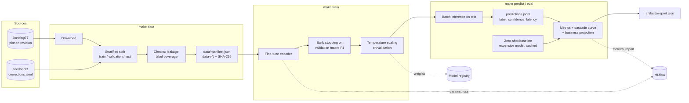
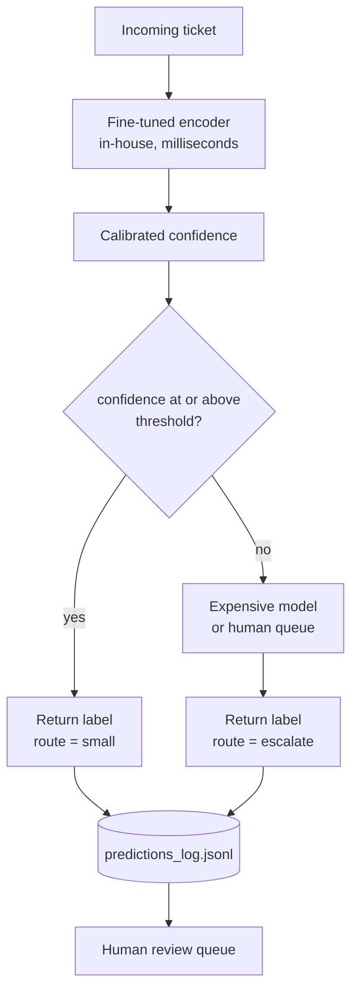
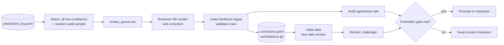
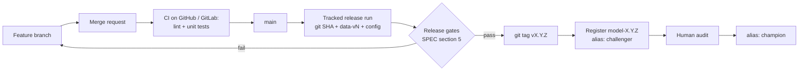
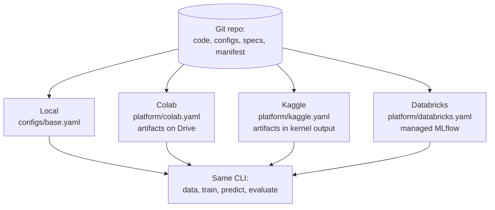

# Architecture — Support-Ticket Triage

The diagrams are Mermaid and render on GitHub and GitLab.

## 1. Training and evaluation pipeline
What `make data train predict eval` does, and what each step writes.

## 2. Inference path: the cascade
How one ticket is handled at run time. The small model answers when it is confident; otherwise the ticket is escalated.

## 3. Human feedback loop

## 4. Versioning and release flow

## 5. Where it runs

